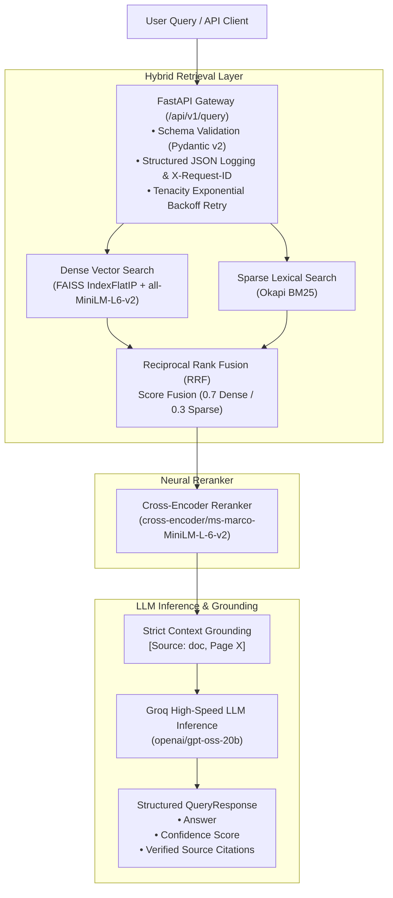

# RAGBOT: Production-Grade Hybrid RAG & REST API Engine

[](https://github.com/MudassirnewKhan/RAGBOT/actions/workflows/ci-cd.yml)
[](https://fastapi.tiangolo.com)
[](https://www.docker.com)
[](https://docs.pytest.org)
[](https://opensource.org/licenses/MIT)

> An enterprise-ready Retrieval-Augmented Generation (RAG) backend combining **dense semantic embeddings (FAISS)** and **sparse lexical search (Okapi BM25)** via **Reciprocal Rank Fusion (RRF)**, refined by a neural **Cross-Encoder reranker**, strictly grounded **citation synthesis**, containerized with **Docker**, and continuously verified via **GitHub Actions CI/CD**.

---

## 🌟 Key Architecture & Features



### 1. Hybrid Retrieval & Neural Reranking (Phase 1)
- **Direct PyMuPDF Document Parsing**: Layout-aware PDF and text parsing extracting text hierarchy, headings, and page boundaries without heavy external wrappers.
- **Structure-Aware Chunker**: Respects paragraph boundaries and sub-splits oversized sections with sliding context overlap.
- **Dual Retrieval Fusion**: Combines dense semantic cosine search (`all-MiniLM-L6-v2`) with sparse keyword matching (`rank-bm25`) using **Reciprocal Rank Fusion (RRF)** to eliminate blind spots in semantic-only search.
- **Cross-Encoder Reranking**: Evaluates joint `(query, passage)` attention scores using `ms-marco-MiniLM-L-6-v2` for precise final candidate scoring.
- **Grounded Citation Generation**: Enforces source attribution (`[Source: filename, Page X]`) and outputs a computed factual confidence score.

### 2. Production REST API Layer (Phase 2)
- **FastAPI Framework**: Modular router architecture (`/health`, `/readiness`, `/api/v1/query`, `/api/v1/documents`).
- **Pydantic v2 Validation**: Strict schema verification with bounds, sanitization, and structured validation error handling.
- **Rate-Limit Resilience**: Tenacity exponential backoff with jitter automatically handling HTTP 429/503 rate limits on LLM inference.
- **Structured JSON Logging**: Every request is tagged with a unique `X-Request-ID` and latency `X-Process-Time` header for distributed tracing.
- **Interactive OpenAPI Documentation**: Interactive Swagger UI served at `/docs`.

### 3. Containerization, Testing & CI/CD (Phase 3)
- **Multi-Stage Dockerfile**: Slim, security-hardened image running under a non-root `appuser`.
- **Docker Compose**: One-command local orchestration with persistent vector storage and data volume mounting.
- **Automated PyTest Test Suites**:
  - **Unit Tests**: Chunking accuracy, minimum lengths, metadata preservation, schema validation edge cases.
  - **Integration Tests**: Simulated API calls verifying HTTP response codes, tracing headers, readiness checks, and error responses.
- **GitHub Actions CI/CD**: Cloud pipeline automatically executing PyTest suites, building the Docker image, and verifying health check probes.

---

## 📁 Project Structure

```text
RAGBOT/
├── .github/workflows/       # GitHub Actions CI/CD Pipeline
│   └── ci-cd.yml
├── app/                     # Production REST API (FastAPI)
│   ├── middleware/          # Structured JSON logging & RFC exception handlers
│   ├── routers/             # API routes (health, query, documents)
│   ├── schemas/             # Pydantic v2 data models
│   ├── utils/               # Tenacity exponential backoff rate limiter
│   ├── config.py            # API settings
│   ├── dependencies.py      # Dependency injection & engine sharing
│   └── main.py              # Application factory & lifespan warming
├── data/                    # Document store (PDFs, TXTs)
├── src/                     # Core Hybrid RAG Engine
│   ├── bm25_index.py        # Okapi BM25 sparse index
│   ├── chunker.py           # Layout-aware semantic chunker
│   ├── config.py            # Global configuration
│   ├── embedding.py         # Singleton SentenceTransformer service
│   ├── pdf_parser.py        # PyMuPDF direct parser
│   ├── rag_engine.py        # Full RAG orchestrator
│   ├── reranker.py          # Cross-Encoder neural reranker
│   ├── text_parser.py       # Unified document loader
│   └── vectorstore.py       # FAISS IndexFlatIP vector store
├── tests/                   # Automated PyTest Test Suite
│   ├── conftest.py          # Test fixtures and TestClient setup
│   ├── integration/         # API endpoint integration tests
│   └── unit/                # Chunker and Pydantic schema unit tests
├── .dockerignore
├── compose.yaml             # Docker Compose orchestration
├── Dockerfile               # Multi-stage production container build
├── pytest.ini               # PyTest configuration
├── requirements.txt         # Project dependencies
└── run_api.py               # Standalone API server runner
```

---

## 🚀 Quickstart Guide

### Option A: Running with Docker (Recommended)

1. **Clone the repository**:
   ```bash
   git clone https://github.com/MudassirnewKhan/RAGBOT.git
   cd RAGBOT
   ```

2. **Configure Environment Variables**:
   Create a `.env` file in the root directory:
   ```env
   GROQ_API_KEY=your_groq_api_key_here
   LLM_MODEL=openai/gpt-oss-20b
   ```

3. **Start with Docker Compose**:
   ```bash
   docker compose up --build
   ```
   The service will boot, pre-warm models, and be available at `http://localhost:8000`.

---

### Option B: Running Locally

1. **Create and Activate Virtual Environment**:
   ```bash
   python -m venv .venv
   # Windows:
   .\.venv\Scripts\activate
   # macOS / Linux:
   source .venv/bin/activate
   ```

2. **Install Dependencies**:
   ```bash
   pip install -r requirements.txt
   ```

3. **Set your API Key**:
   Create a `.env` file with `GROQ_API_KEY=your_key_here`.

4. **Launch the API Server**:
   ```bash
   python run_api.py
   ```

5. **Access the API Docs**:
   Open [http://localhost:8000/docs](http://localhost:8000/docs) in your browser.

---

## 🧪 Running Automated Tests

Run the full automated PyTest test suite locally:

```bash
pytest -v
```

Output:
```text
tests/integration/test_api_endpoints.py::test_health_endpoint PASSED     [ 12%]
tests/integration/test_api_endpoints.py::test_readiness_endpoint PASSED  [ 25%]
tests/integration/test_api_endpoints.py::test_query_validation_error PASSED [ 37%]
tests/unit/test_chunker.py::test_chunk_document_basic PASSED             [ 50%]
tests/unit/test_chunker.py::test_chunk_document_empty_input PASSED       [ 62%]
tests/unit/test_schemas.py::test_query_request_valid PASSED              [ 75%]
tests/unit/test_schemas.py::test_query_request_empty_query PASSED        [ 87%]
tests/unit/test_schemas.py::test_query_request_invalid_top_k PASSED      [100%]

======================== 8 passed in 1.84s =========================
```

---

## 📡 API Reference & Example Usage

### 1. Health Liveness Probe
```bash
curl -X GET http://localhost:8000/health
```
```json
{
  "status": "ok",
  "timestamp": "2026-11-22T19:00:00.000000",
  "service": "RAGBOT REST API"
}
```

### 2. Readiness Probe
```bash
curl -X GET http://localhost:8000/readiness
```
```json
{
  "ready": true,
  "vector_count": 285,
  "embedding_dimension": 384,
  "llm_model": "openai/gpt-oss-20b",
  "reranker_model": "cross-encoder/ms-marco-MiniLM-L-6-v2"
}
```

### 3. Query Knowledge Base
```bash
curl -X POST http://localhost:8000/api/v1/query \
  -H "Content-Type: application/json" \
  -d '{
    "question": "What is the primary role of the Cross-Encoder in this pipeline?",
    "top_k": 3
  }'
```
```json
{
  "answer": "The Cross-Encoder acts as a second-stage neural reranker. It performs joint attention scoring over (query, document) pairs to refine initial candidates retrieved via dense and sparse search [Source: rag_architecture.pdf, Page 3].",
  "confidence": 0.94,
  "sources": [
    {
      "file": "rag_architecture.pdf",
      "page": 3,
      "chunk_index": 12,
      "relevance_score": 5.48,
      "retrieval_method": "hybrid"
    }
  ]
}
```

---

## 🏷️ Release History
- **`v0.1.0-phase1-rag-engine`**: Layout-aware PyMuPDF parsing, FAISS + BM25 hybrid retrieval via RRF, and Cross-Encoder neural reranking.
- **`v0.2.0-phase2-rest-api`**: Production FastAPI service with Pydantic v2 schemas, rate-limiting retry mechanism, and structured tracing middleware.
- **`v0.3.0-phase3-docker-cicd`**: Multi-stage Docker containerization, automated PyTest suites, and GitHub Actions CI/CD automation.

---

## 📄 License
This project is open-source and licensed under the [MIT License](LICENSE).
